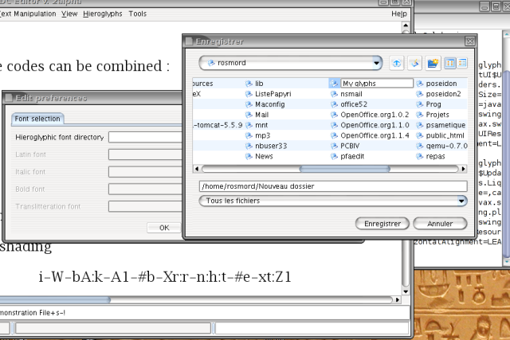
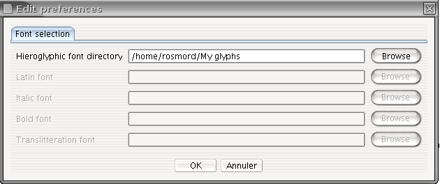
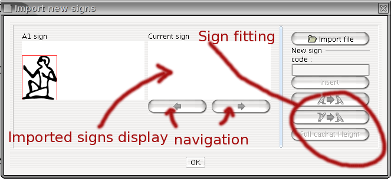
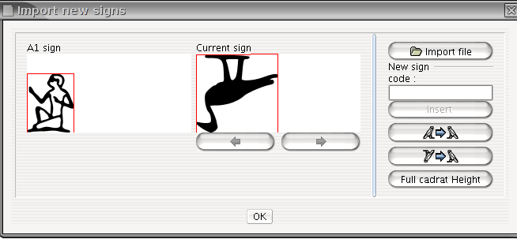
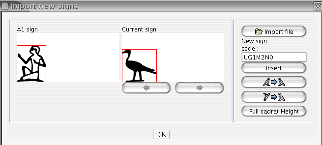

## Choisir un dossier pour vos signes

Afin de pouvoir ajouter de nouveaux signes, vous devez d'abord choisir où ils seront stockés sur votre ordinateur. Pour ce faire, sélectionnez simplement « Outils/Modifier les préférences ».
Dans l'onglet « Sélection des polices » (le seul disponible actuellement), saisissez le dossier que vous souhaitez utiliser dans le champ « Répertoire des polices hiéroglyphiques ». Vous devriez créer un dossier vide à cet effet.

Création d'un dossier :

Sélection du dossier :

Vous n'avez à le faire qu'une seule fois. Les prochains lancements de JSesh utiliseront ce dossier.

## Attacher des codes aux dessins et les insérer dans JSesh

Une fois que vous avez dessiné un signe, ou que vous l'avez obtenu à partir de la [bibliothèque de signes JSesh](https://jsesh.qenherkhopeshef.org/glyphs) ou d'une autre source, il est temps de lui donner un nom.

Sauf lorsque vous créez des signes qui sont déjà documentés dans le Manuel de codage (par exemple, parce qu'ils ne sont pas disponibles dans JSesh), vous devez d'abord obtenir un identifiant d'utilisateur (UID), qui différenciera vos signes des signes créés par d'autres utilisateurs.

Pour obtenir un UID, enregistrez-vous en tant qu'utilisateur JSesh. Remarque pour les utilisateurs de tksesh : l'UID est simplement votre identifiant tksesh.

Soyez prudent lorsque vous donnez un nom aux signes. Vous voulez que vos fichiers soient lisibles par n'importe qui : soyez donc fidèle au *Manuel de codage*. Nos suggestions actuelles sont les suivantes :

* Si vous créez votre propre version d'un signe du Manuel (soit parce qu'il n'est pas encore disponible dans JSesh, soit parce que vous n'aimez pas le signe fourni par défaut), utilisez soit le code standard du Manuel de codage pour ce signe, soit la notation suivante : `US` + **uid** + `code Gardiner`, où **uid** est l'identifiant de l'utilisateur. Par exemple, si votre identifiant est 527834, ce sera `US527834A1VARA` pour une variante de `A1`.

* Lorsque vous créez un signe que vous considérez comme une variante d'un signe standard, vous devez construire son nom ainsi : **USuid+code Gardiner+"VAR"+CODE VARIANTE**, où :
  * le code Gardiner est le code standard du Manuel de codage pour le signe de base ;
  * CODE VARIANTE est généralement une lettre majuscule.

  Par exemple, la forme habituelle de wn (E34) à l'époque ramesside a la queue de l'animal de Seth. Si je veux la distinguer du signe « normal », je peux l'appeler `US1E34VARA`.

* Lorsque le signe que vous créez correspond à un signe entièrement nouveau, donnez-lui un code de la forme : **USuid+catégorie Gardiner+NUMÉRO+"XT"+CODE VARIANTE OPTIONNEL.**

  Vous êtes libre de choisir le numéro qui vous convient, mais je vous suggère d'essayer de trouver une disposition logique. Il serait également préférable que ce numéro ne corresponde pas à un signe « standard » (pour éviter d'induire en erreur les utilisateurs innocents d'autres logiciels). Vous pouvez donc, par exemple, commencer votre numérotation à 1000. Notez également que le numéro ne doit pas contenir de zéros non significatifs. La catégorie doit être correcte, et si vous n'en avez vraiment aucune idée, vous devez utiliser la catégorie Aa. « Ff » est réservé aux signes utilisés spécifiquement pour la transcription hiératique.

  Exemple : la harpe du Louvre E 116 A a récemment été publiée par C. Barbotin (*La voix des hiéroglyphes*, p. 66-67), et dans son texte figure le signe inconnu . Je peux créer ce signe et lui donner, par exemple, le code `US1Aa1000XT`. D'autre part, la stèle d'Israël contient un signe qui est très probablement un griffon, mais qui ne correspond à aucun signe de griffon enregistré dans le Manuel. Je lui ai donc donné le code `US1E162VARA`, car E162 est un signe de griffon.

* Utilisation de ce système lors de l'import de textes depuis d'autres logiciels : il est possible que d'autres logiciels fournissent leurs propres codes « non standard ». Si vous souhaitez importer dans JSesh des textes issus de ces logiciels, vous devrez peut-être donner un nom aux nouveaux signes qu'ils contiennent (notez que les polices sont généralement protégées par le droit d'auteur : vous devrez donc redessiner les signes vous-même, soit en adaptant des signes JSesh existants, soit en trouvant une image des signes dans les sources hiéroglyphiques originales). Pour des raisons de compatibilité, les identifiants utilisateur suivants peuvent être utilisés pour d'autres logiciels :

| logiciel    | identifiant utilisateur de substitution |
| ----------- | --------------------------------------- |
| winglyph    | 1000                                    |
| macscribe   | 1001                                    |
| inscribe    | 1002                                    |
| got         | 1003                                    |
| visualglyph | 1004                                    |

Si vous pensez à d'autres logiciels que je devrais ajouter, dites-le-moi.

* Code standard du Manuel de codage. Vous trouverez ces codes dans le dictionnaire de Hannig (*Wörterbuch*), par exemple. Un certain nombre de listes sont également disponibles sur le Web. Veuillez noter que l'utilisation des codes est une chose, mais que les dessins des signes dans les polices d'autres logiciels sont protégés par la loi sur le droit d'auteur. Vous devez donc proposer vos propres versions des signes, soit à partir de sources réelles, soit en les recréant. Vous trouverez plus d'informations sur le dessin des signes dans la section suivante. Dans notre exemple, votre canard remplacerait le canard normal ; il aurait donc le code « G39 ».

Nous suggérons que, si vous créez un signe avec un code Gardiner « normal », vous lui donniez également un code de signe utilisateur. De cette façon, vous serez sûr de le conserver même si un signe avec ce code Gardiner est ajouté ultérieurement au logiciel.

Notez que, pour la compatibilité avec tksesh, nous prenons également en charge des « codes de glyphes utilisateur » arbitraires. Ces codes correspondent aux codes que tksesh a donnés aux nouveaux signes. Les codes de glyphes utilisateur ont la forme **UG id M mid N sid**, où id, mid et sid sont des nombres. Évitez d'utiliser ces codes pour le moment.

## Insertion effective des signes

## Signes prêts pour JSesh

Le moyen le plus simple d'ajouter des signes à votre bibliothèque est de créer des fichiers SVG de la bonne taille. Vous devez utiliser, pour le cadrat entier, des dimensions de 1800 px x 1800 px. Bien sûr, l'image peut être plus petite si le glyphe n'occupe pas un cadrat entier.

JSesh peut aussi utiliser des signes dont le cadrat de base mesure 18 px, mais je vous suggère de l'éviter.

Votre fichier SVG doit avoir un nom qui correspond à un code (par exemple `US1A1VARA.svg`).

Dans ce cas, vous pouvez simplement copier votre fichier dans votre dossier de hiéroglyphes JSesh, et le signe sera disponible.

## Système alternatif

Il existe également un système secondaire, qui peut vous aider à redimensionner les signes et à choisir un nom correct. J'avoue que je ne m'en suis pas servi depuis des années.

L'interface d'import de signes peut être lancée à partir du menu « Outils/Ajouter de nouveaux signes ».

L'import des signes se fait en deux phases :

* vous importez une image ou un ensemble d'images à partir d'un fichier (dessins SVG, polices TrueType, etc.) ;

* vous attribuez un code à chaque signe que vous avez importé, puis vous insérez le nouveau signe dans la liste des signes de JSesh.

### Importer des dessins

L'importation de dessins est simple. JSesh peut lire :

* des polices TrueType ;
* des fichiers .tml et bzr, qui peuvent être créés avec le précurseur de JSesh, tksesh ;
* des fichiers SVG.

Cliquez simplement sur le bouton « Importer le fichier », et sélectionnez le fichier qui contient votre (vos) image(s). Vous pouvez utiliser les boutons de navigation (ceux avec des flèches) pour parcourir les signes disponibles.

### Nommer votre signe

Vous devez ensuite nommer votre signe. JSesh essaiera de deviner un nom à partir du nom du fichier, mais il peut se tromper.

**Note** : donner un nom ne signifie pas que le signe a été enregistré dans votre bibliothèque. Rien n'est fait tant que vous n'avez pas appuyé sur le bouton « Insertion ».

### Affiner vos signes

Dans certains cas, la taille ou l'orientation de vos signes ne sera pas correcte. Par exemple, dans l'image ci-dessous, le canard est trop gros et son orientation est erronée.

Vous pouvez corriger ceci :

* les boutons  et  peuvent être utilisés pour changer l'orientation du signe ;
* le bouton « Pleine hauteur cadrat » donne au signe la même taille que le signe A1 ;
* si vous cliquez sur la fenêtre du signe et faites glisser la souris, la position de la souris définira la hauteur du signe.

Lorsque votre signe est prêt, **cliquez sur le bouton « Insertion »**. Sinon, il ne se passera rien.
