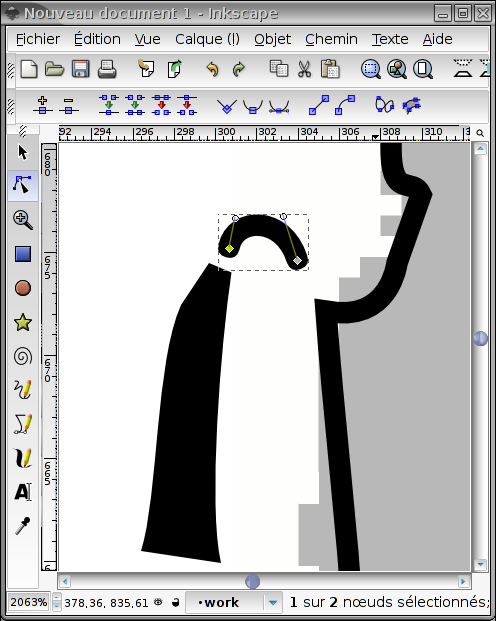
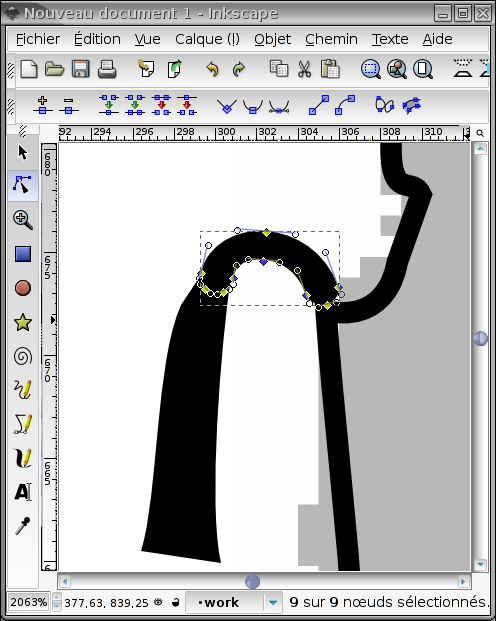
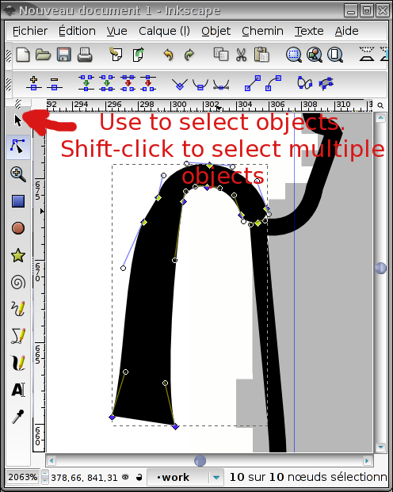
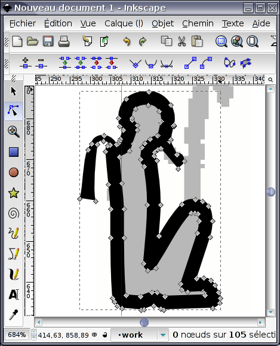

## Présentation

JSesh n'inclut pas encore d'éditeur de hiéroglyphes. Cependant, il peut inclure des signes dessinés avec un certain nombre d'autres logiciels, comme FontForge et Inkscape. Même si un éditeur de signes est ajouté un jour, cette fonctionnalité sera conservée.

Dans ce tutoriel, je montre comment utiliser le logiciel Inkscape pour créer un nouveau hiéroglyphe.

Dessiner un nouveau signe est une tâche assez longue et fastidieuse. Cela nécessite une compréhension de base des éditeurs graphiques vectoriels (Inkscape, Adobe Illustrator...), ce qui n'est pas anodin, et cela demande de toute façon beaucoup de travail. Non seulement vous devez dessiner de jolis signes, mais ces signes doivent aussi s'harmoniser avec les autres polices.

## Quelques notions sur le dessin vectoriel

Dessiner des images vectorielles nécessite une certaine compréhension du sujet. Nous écrirons quelque chose à ce sujet plus tard (sauf si une âme bienveillante veut bien nous fournir un joli tutoriel libre de droits).

Exigence pour les signes utilisables par JSesh : vous devez dessiner vos signes sous forme de contours remplis en noir sur fond blanc. Le module d'import de JSesh peut lire des contours non remplis, mais l'import donnera de meilleurs résultats avec des contours remplis, de largeur de trait nulle. Inkscape est capable de convertir des courbes en contours, ce n'est donc pas une exigence très lourde.

## Création d'une image de fond

Vous pouvez commencer par obtenir une image du glyphe que vous souhaitez créer. Cette image peut être un dessin au trait ou une photographie d'un glyphe réel. Il faut que les lignes noires de votre signe restent lisibles : changez donc les couleurs si nécessaire (par exemple, si vous avez un dessin au trait du signe, colorez-le en gris clair).

Notre exemple sera un rendu basse résolution du signe C102 (Ptah assis avec un wꜣs) de la stèle d'Israël. Le bitmap d'origine est . Avec un programme de dessin, nous avons estompé l'image pour obtenir .

## Dessiner le contour

Nous démarrons maintenant Inkscape et y importons le dessin bitmap. Créez un nouveau calque et appelez-le « travail ». De cette façon, nous ne perturberons pas le dessin bitmap.
Nous allons ensuite tracer un contour approximatif de la forme du signe.
Comme nous ne sommes pas de grands dessinateurs, nous utilisons pour cela l'outil « Courbe de Bézier ». On obtient le résultat suivant :

Notez que nous avons sélectionné « pas de remplissage » et une petite largeur de contour. Nous avons également laissé de côté le signe « wꜣs ».

## Ajuster le contour

Des segments de droite ne feront pas un bon signe. Nous convertissons donc certains d'entre eux en courbes, nous ajoutons de nouveaux points si besoin, etc.
Nous commençons par la tête :

Et voici le résultat :

## Travail sur les détails

Nous voulons que nos signes soient lisibles en petite taille ; nous ne mettrons donc pas trop de détails.

## La barbe de Ptah

Le contour du corps de Ptah sera épaissi pour faire le signe final. Mais nous aimerions que la barbe soit pleine (ici, nous avons donné à Ptah une barbe osirienne, ce qui est une erreur). Par conséquent, nous devons la séparer du reste du dessin. Cela se fait en sélectionnant les points de contrôle qui séparent la barbe du corps :

Puis, en choisissant l'entrée « Séparer » dans le menu « Chemin », on obtient deux objets : la barbe et le reste du corps.
On peut alors combler le vide que l'on vient de créer (et donner un menton à Ptah) :-)

Maintenant, la barbe doit elle aussi être fermée. Nous modifions les paramètres de remplissage et de contour de la barbe : nous lui donnons un remplissage noir uni et aucun contour. Si la barbe est trop fine, nous pourrons l'épaissir avec l'action « Dilater » du menu « Chemin ».

## Le contrepoids du collier de Ptah

Pour celui-ci, le scan d'origine est un peu approximatif. Nous creusons un peu l'iconographie, et nous arrivons à un collier avec contrepoids en deux parties.

Le collier est composé de deux parties : une cordelette et le contrepoids lui-même. La cordelette est un simple trait courbe et le contrepoids est une forme pleine.

Nous voulons les joindre en un seul objet, qui sera une forme pleine. Pour ce faire, nous convertissons d'abord le contour en chemin.

Nous sélectionnons ensuite les deux parties du collier, et nous utilisons l'opérateur « Union » du menu « Chemin ».

## Choisir la bonne largeur de ligne

À ce stade, vous souhaiterez peut-être enregistrer votre travail deux fois : une fois comme sauvegarde, et une autre, bien sûr, comme fichier de travail. Sélectionnez maintenant le dessin principal et choisissez pour lui une largeur de trait raisonnable. Elle doit s'harmoniser avec le reste des polices. Il peut être intéressant de faire un zoom arrière afin de voir le signe tel qu'il sera rendu.

## Tout unir

Assurez-vous maintenant que tous les traits sont transformés en chemins, et utilisez l'opérateur « Union » sur eux. Vous devriez obtenir ceci :

Je vous suggère fortement de conserver une version de sauvegarde de votre signe dans laquelle les traits n'ont pas été transformés en chemins : cela vous permettra de retravailler votre signe plus facilement, ou de le réutiliser dans le cadre d'autres signes. C'est ce que je fais pour mes polices ramessides.

## Ajout d'autres détails

En utilisant les mêmes techniques, nous arrivons au résultat final :

que nous sauvegardons sous le nom `C102.svg`.

## Commentaires finaux

À partir d'une image de résolution plutôt faible, nous pouvons obtenir un glyphe d'apparence correcte. N'oubliez pas que le signe sera plutôt petit, et n'ajoutez pas trop de détails (donner la possibilité d'augmenter le niveau de détail du signe avec sa taille est une option intéressante, utilisée dans les polices en plomb de Gardiner). Essayez de vous harmoniser avec les signes existants. En fait, si vous avez des sources SVG pour des signes similaires, essayez de les réutiliser.

Le signe donné dans cet exemple n'est pas un très bon exemple. Le « wꜣs », par exemple, est trop haut, et le signe ne s'harmonisera pas bien avec les polices existantes. Nous devrions donc raccourcir le sceptre. En général, notre Ptah est trop maigre par rapport aux autres signes. Garder des étapes intermédiaires de votre travail vous permettra de corriger les choses plus facilement. Par exemple, si les traits sont trop épais et que vous avez conservé une version du signe où les traits sont encore des traits et n'ont pas encore été remplacés par des chemins, la correction est très facile.
