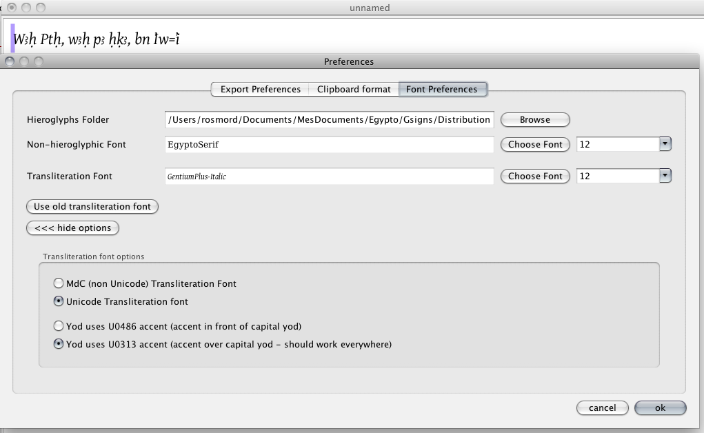

Pour utiliser une police Unicode, vous devez disposer d'une police contenant les bons signes. Vous trouverez [une page sur la translittération](https://jsesh.qenherkhopeshef.org/fr/varia/transliteration) sur le site de JSesh ; [Daniel Werning](https://aaew.bbaw.de/egyptological-unicode-fonts) maintient une liste similaire, peut-être plus à jour.

- Ouvrez le menu « Préférences » (sur Mac, il se trouve dans le menu « JSesh » ; ailleurs, sous le menu « Édition »).
- Allez dans l'onglet « Préférences de polices ».
- Sélectionnez une police pour la translittération.
- Ouvrez le panneau « Afficher les options » et cochez « Police de translittération Unicode ».

## Problèmes actuels avec les polices Unicode

Le support actuel des polices de translittération dans les systèmes d'exploitation et les logiciels n'est pas bon. Même Java sur Mac, et donc JSesh, a des problèmes.

Les vrais problèmes sont H̱ et yod.

### H̱ majuscule

Sur certains systèmes, H̱ (comme dans le dieu-bélier *H̱nmw*) s'affiche mal. Cela dépend de la police **et** du logiciel **et** du système. Dans la plupart des cas, tout va bien. Une exception ennuyeuse : le résultat n'est pas bon avec JSesh **sur Mac OS X**. Apparemment, le système de rendu donne de meilleurs résultats sous Windows. Notez que si vous collez votre texte dans un traitement de texte, vous obtiendrez probablement un bon résultat de toute façon.

### Yod

**obsolète - ajouter le code A7BC**.

Unicode vous offre un certain nombre de choix. J'ai sélectionné les deux meilleures solutions (la troisième, qui utilise une sorte de demi-cercle comme accent du yod, ne fait que reproduire une astuce datant de l'époque des machines à écrire, où l'on fabriquait à la main les yods avec des lettres « c »). Le problème est que, techniquement, le support de ces solutions fait défaut.

Le yod est censé être codé avec un « i » (un i *pointé*, pas un sans point) et un accent. La police doit contenir suffisamment d'informations pour afficher correctement ces signes. Le problème est que beaucoup de logiciels ne regardent pas le contenu de la police et fonctionnent par eux-mêmes. Le résultat est que le point n'est pas supprimé sur de nombreux systèmes (y compris JSesh sur Mac). Le positionnement de l'accent devant le « I » majuscule est un autre problème.

Avec une configuration correcte, il est possible d'obtenir de bons résultats avec OpenOffice et Word.

Les deux possibilités pour le yod sont :

- U+0313 : comme « i + virgule suscrite » est déjà utilisé dans d'autres langues, ses chances d'être correctement supporté sont meilleures. Le seul problème est que, dans l'affichage normal de cette combinaison pour le « I » majuscule, l'accent est censé être au-dessus du I. Or, comme vous le savez, l'affichage correct du yod majuscule place l'accent devant le « I ». Si vous pouvez vivre avec cela, cette solution est la plus sûre. Elle donne de bons résultats dans la plupart des cas (mais pas avec Java et Mac OS X, donc l'affichage de JSesh sur Mac n'est pas correct).

- U+0486 : cet accent a la particularité intéressante de n'être utilisé pour rien d'autre sur les lettres latines. Une police est donc libre de le placer devant le « I » majuscule. En théorie, c'est la bonne solution. En pratique, cela fonctionne avec certains logiciels, mais pas tous. OpenOffice donne de bons résultats, ainsi que le logiciel tout simple TextEdit sur Mac. J'ai pu réussir avec Word sur Mac en activant toutes les ligatures.

JSesh ne prend pas en charge le système IFAO/Unicode actuel. Cette norme était un « patch » temporaire utilisant des signes Unicode disponibles, mis en place lorsqu'aucun codage n'existait pour la translittération égyptienne.
Maintenant que « aleph » et « ayin » ont un code, j'encourage (enfin, j'impose) leur utilisation.

### Références

* [Article Wikipédia sur la translittération et Unicode](http://en.wikipedia.org/wiki/Transliteration_of_Ancient_Egyptian)
