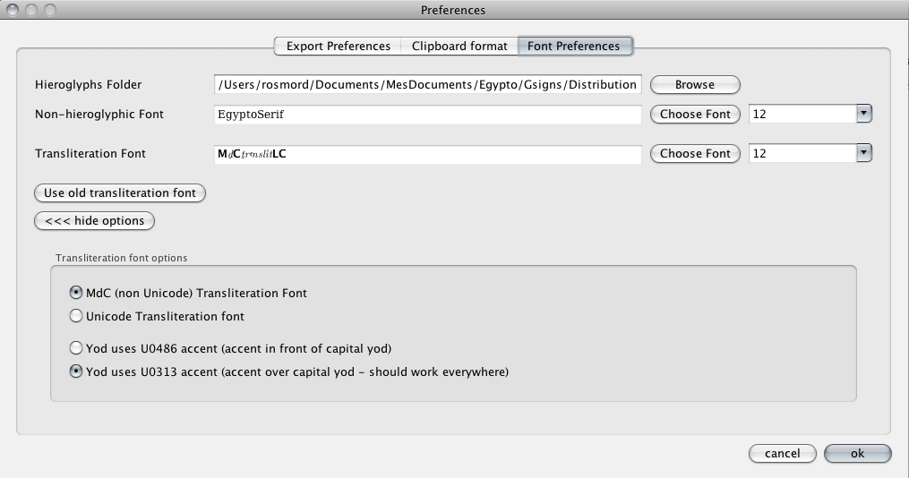

**JE VOUS CONSEILLE FORTEMENT D'UTILISER UNICODE** (désolé de crier, mais c'est important).

Vous pouvez sélectionner une police avec un codage compatible MdC. Dans ce cas, JSesh ne traite pas les majuscules. Vous pouvez choisir votre propre police, si vous en avez une, ou utiliser la police de translittération par défaut de JSesh. Une version de cette police est embarquée dans le logiciel, mais vous pouvez l'installer sur votre système (pour l'utiliser avec un traitement de texte, par exemple). Une copie de cette police est disponible dans le dossier des polices de l'installation de JSesh.

## Méthode simple avec l'ancienne police

Ouvrez le menu « Préférences » (sur Mac, il se trouve dans le menu « JSesh » ; ailleurs, sous le menu « Édition »). Allez dans l'onglet « Préférences de polices » et cliquez sur le bouton « Utiliser l'ancienne police de translittération ».

Et c'est tout. Pour vos propres documents Word (ou OpenOffice...), vous pouvez trouver la police dans le dossier de l'application JSesh (dans le dossier « Polices » sur Mac).

## Utiliser vos propres polices compatibles MdC

Si vous avez une police compatible avec le MdC (c'est-à-dire où « a » représente un ayin, « A » représente un aleph, etc.), vous pouvez également l'utiliser.

Sélectionnez simplement votre police (avec « Choisir la police » en face de la police de translittération), puis, dans les options avancées, sélectionnez « Police de translittération MdC (non Unicode) ».
