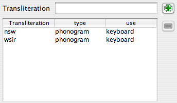

Il est possible de documenter les hiéroglyphes (et en particulier les nouveaux signes) afin que la palette puisse mieux les gérer. Ceci est bien sûr utile pour vos propres nouveaux signes, mais aussi pour les signes JSesh « standard », car les informations sur les signes fournies par JSesh sont actuellement très partielles. Les commentaires des utilisateurs seraient ici les bienvenus, et surtout ceux des professionnels.
La principale caractéristique de la version 2.4.15 de JSesh est la disponibilité d'un éditeur convivial pour ajouter des informations sur les signes.

## Démarrage de l'éditeur de description de signes

L'éditeur de description de signes est un programme distinct. Pour le démarrer :

* sur Windows, il existe un raccourci pour cela
* sur Linux, il devrait y en avoir un aussi
* sur Mac, allez dans votre dossier d'installation JSesh. Vous trouverez l'éditeur dans le dossier « bin ». Il s'appelle signInfoEditor.command.

Veuillez noter que vous pouvez utiliser l'éditeur à volonté, tant que vous n'enregistrez rien. Lorsque vous enregistrez, le résultat sera utilisé la prochaine fois que vous lancerez JSesh.

## Modification des descriptions des signes

Les signes sont définis par les informations suivantes :

* Les translittérations associées au signe
* Les signes qui sont des composants de ce signe. Par exemple, A6 contient un signe W54
* Le(s) signe(s) dont ils sont des variantes
* Des descriptions en texte libre du signe, pouvant inclure par exemple des remarques bibliographiques
* Les tags sont de courts éléments de description attachés aux signes et utilisés pour les sélectionner. Par exemple, « ennemi » est attaché aux signes qui représentent un ennemi.

Lorsque vous démarrez l'éditeur de description de signes, il lit automatiquement les descriptions de signes standard ainsi que vos propres descriptions. Vous pouvez ensuite ajouter ou modifier des données, et enregistrer le résultat (en choisissant simplement « Enregistrer » dans le menu). Notez que l'éditeur vous empêchera de modifier les informations stockées dans les descriptions des signes système.

Une caractéristique importante de l'éditeur est que vous pouvez utiliser la palette de signes (à partir du menu « Outils ») pour sélectionner des signes.

## La fenêtre principale de l'éditeur d'informations sur les signes

La fenêtre principale de l'éditeur d'informations sur les signes permet de modifier les informations sur un signe donné. La sélection du signe sur lequel vous souhaitez travailler peut se faire de plusieurs manières. Vous pouvez naviguer avec les flèches en bas de la fenêtre, taper le code du signe dans le champ « Code », ou simplement faire glisser et déposer le signe depuis la palette. Une fois qu'un signe apparaît, vous pouvez ajouter des informations à son sujet.

La case à cocher « signe de base » est utilisée pour indiquer que le signe doit apparaître dans la palette de signes même si « afficher tout » n'est pas sélectionné.

À partir de cette fenêtre, vous pouvez modifier les translittérations des signes et bien d'autres choses. La partie inférieure de la fenêtre donne accès à trois types d'informations : les relations entre ce signe et les autres signes, la description en texte libre du signe et les tags.

## Translittération

Il est possible d'associer plusieurs translittérations à un signe donné. Les translittérations peuvent être utilisées dans divers contextes : pour rechercher un signe (dans la palette, ou en tapant la translittération directement au clavier), ou simplement à titre informatif, pour des translittérations peu courantes.

### L'éditeur de translittération

Pour saisir une nouvelle translittération, appuyez simplement sur le bouton « + ». Si vous saisissez du texte dans le champ « translittération », ce texte sera utilisé comme nouvelle translittération.

Si vous souhaitez supprimer une de vos translittérations, sélectionnez la ligne et appuyez sur le bouton « moins ». Ce bouton est grisé si aucune ligne n'est sélectionnée, ou si la ligne sélectionnée ne peut pas être supprimée.
Vous pouvez alors ajuster les valeurs « type » et « utilisation ».

Je ne sais plus si le « type » est utile ou non, et il n'est actuellement pas utilisé par JSesh. La colonne « utilisation » est en revanche assez importante.

La colonne « utilisation » explique dans quel contexte cette translittération est utilisée dans le logiciel. Notez que chaque niveau d'utilisation est inclus dans le suivant. Par exemple, si vous choisissez « clavier », le signe sera également utilisé dans les contextes « palette » et « informatif ».

#### Types

* phonogramme :
* idéogramme : doit être utilisé à la fois pour les idéogrammes simples (ceux suivis de Z1), et pour les déterminatifs dits phonétiques, qui sont en réalité des idéogrammes déguisés.
* abréviation : à utiliser pour les signes qui sont de véritables abréviations de mots. Ils ne sont normalement pas suivis de Z1 par écrit. Exemple : G37 peut être utilisé comme abréviation pour « Sri ».
* typique : le signe est typique pour un mot. Souvent utile pour certains déterminatifs. Je l'utilise pour la valeur « bin » de G37.
* clavier : le signe sera accessible via cette translittération dans JSesh lors de l'utilisation du clavier pour saisir des signes. Par exemple, la translittération « iw » de D54.
* palette : le signe ne sera pas accessible depuis le clavier via cette translittération, mais sera accessible via la palette. Notez que si un utilisateur utilise la translittération pour accéder à un signe dans la palette, il pourra y accéder par sa translittération par la suite.
* informatif : la translittération n'est donnée qu'à titre informatif. Elle apparaîtra dans le champ « valeur » de la palette, mais c'est tout.

## Éditeur de *parties de signe*

L'éditeur de *parties de signe* permet de décrire les éléments d'un signe en tant que composants d'autres signes. Par exemple, le roi de Haute-Égypte A44 porte une couronne blanche, tient un sceptre nekhakha et porte également un uræus. Tous ceux-ci, à leur tour, sont des hiéroglyphes. Notez que vous n'avez pas besoin de lister toutes les parties. Par exemple, si un dieu porte la couronne Atef, qui à son tour contient la plume de Maât, ne mentionnez pas la plume. Elle est déjà incluse dans le signe de l'Atef (merci à J. Hallof pour cette remarque pendant la conférence d'Oxford 2006).

## Éditeur de variantes

La notion de variante est délicate. En fait, elle n'est pas si bien définie et, pire encore, sa signification utile peut dépendre du contexte. Il y a en fait deux notions. L'une est graphique : une **variante graphique** d'un signe est un signe qui **ressemble** à un autre. L'autre est linguistique : un signe est une **variante linguistique** d'un autre s'il a les **mêmes valeurs et usages**. Les deux notions se chevauchent souvent, mais pas toujours. Par exemple, Y2 est à la fois une variante graphique de Y1 et une variante linguistique de celui-ci. En revanche, `A17A` A17A n'est qu'une variante graphique de A17 A17. Il n'a pas du tout les mêmes usages ; Z7 Z7 et G43 G43 sont des variantes linguistiques, mais pas du tout des variantes graphiques.

Ces notions seront utilisées par JSesh à la fois pour la palette de signes (avec son bouton « variante de ») et pour le système de recherche. Il peut être utile, lors de la recherche de mots avec G43, de retrouver ceux avec Z7.

* est similaire : à cocher si les signes « se ressemblent ».
* niveau de similitude : indique à quel point la relation entre les deux signes est étroite. Il peut s'agir de :
  * complet : une variante complète d'un signe S est un signe avec exactement les mêmes usages et valeurs que S.
  * partiel : les usages se chevauchent de manière significative. Habituellement, la variante couvrirait certains des usages du signe original.
  * autre : autres types de variantes. Par exemple, D36 (le bras) peut être considéré comme une variante de D37 (le signe « rdi ») dans certains contextes, mais les deux signes ont une identité bien distincte.
  * non : le signe n'est pas du tout une variante linguistique
  * non précisé : vous ne savez pas vraiment, ou n'avez pas le temps de vous en soucier.

## Éditeur de descriptions

Ce champ permet des commentaires en texte libre pour les signes. L'utilisation la plus importante est de documenter les signes peu communs, en donnant des références bibliographiques à leur sujet, et en général en aidant l'utilisateur à sélectionner le meilleur signe possible. Si vous souhaitez que la description de votre signe soit incluse dans la version distribuée de JSesh, elle doit comporter des références bibliographiques pour étayer vos affirmations. Veuillez également noter que JSesh est un logiciel libre, mais qu'il doit respecter le droit d'auteur. Ce n'est donc pas le lieu pour copier aveuglément les listes de signes des grammaires usuelles (cela ne veut pas dire bien sûr que vous ne pouvez pas les utiliser comme sources). Vous pouvez écrire des descriptions dans plusieurs langues, même s'il serait préférable qu'il y ait une version anglaise pour chaque signe. Cela dit, JSesh lui-même n'utilise actuellement que la version anglaise.

## Éditeur de liste de tags

Cette fenêtre permet de décrire un signe selon divers mots descriptifs courts appelés « tags ». Ceux-ci sont disponibles dans la palette pour sélectionner des sous-catégories d'une famille donnée. Exemple : les personnages « debout » (évidemment, les tags utilisés ici ne s'appliquent pas à A44). La fenêtre de gauche affiche tous les tags disponibles, listant d'abord ceux qui sont déjà utilisés pour cette famille, puis les autres tags. La meilleure façon d'attribuer des tags aux signes est de regarder des signes similaires et de voir comment cela a été fait.

J'aimerais attirer votre attention sur des tags très utiles, qui sont un peu différents. Il s'agit de « signe grand et étroit », de « signe bas et large » et de « signe long et étroit ». Ces tags sont utilisés en tant que familles spéciales dans la palette JSesh.

Pour ajouter un nouveau tag à un signe, sélectionnez simplement le tag dans la liste de gauche et cliquez sur la flèche « de gauche à droite ». Pour supprimer un tag, utilisez le même principe. Notez que vous ne pouvez pas supprimer les tags qui sont fournis dans la liste JSesh « officielle ».

## La fenêtre de création de tags

Cette fenêtre (accessible via le menu « Outils ») permet de créer de nouveaux tags et de leur associer une traduction multilingue. Ces traductions ne sont pas utilisées actuellement.

## Les menus

### Fichier

* Ouvrir le fichier par défaut de l'utilisateur : ouvre le fichier qui contient vos propres définitions de signes. Celles-ci seront automatiquement utilisées par JSesh lors de son prochain lancement.
* Enregistrer : enregistre votre travail dans votre fichier de définition personnel. Tant que cela n'a pas été fait, votre fichier est inchangé.
* Effacer : crée un tout nouvel espace de travail, sans aucune donnée autre que les données « officielles ». Votre fichier utilisateur ne sera de toute façon modifié que si vous enregistrez votre travail.

### Modifier

* Copier : copie la définition de ce signe pour une utilisation future
* Coller : colle les données copiées pour un autre signe dans cette définition de signe. Très utile pour traiter des variantes proches.

### Outils

* Afficher/Masquer la palette : permet d'ouvrir la palette des signes, pour sélectionner les signes (par glisser-déposer)
* Afficher l'éditeur de tags : ouvre (ou ferme) la fenêtre de l'éditeur de tags, pour créer de nouveaux tags.

## Contribuer vos descriptions de signes à JSesh

Vos descriptions de signes sont stockées dans un fichier appelé `signs_definition.xml`, qui est placé dans :

* `(Votre répertoire personnel)/Library/Preferences/JSesh` sur Macintosh. Par exemple : `/Users/rosmord/Library/Preferences/JSesh/signs_definition.xml` sur ma machine.
* `C:\Users\VOTRE LOGIN\JSeshData` sur Windows (en gros, JSeshData dans votre dossier personnel). Normalement, le répertoire JSeshData est créé par JSesh, vous pouvez donc le rechercher si vous avez des doutes. Par exemple, `C:\Users\Rosmord\JSeshData`.
* `$HOME/.jsesh` sur Linux.

Pour apporter votre contribution à la description des signes de JSesh, envoyez-moi simplement ce fichier. Je déciderai de ce qui peut aller dans la distribution générale de JSesh. Il y a beaucoup de problèmes que je dois prendre en compte : le logiciel doit rester assez général, assez correct, et je dois éviter les atteintes au droit d'auteur.
