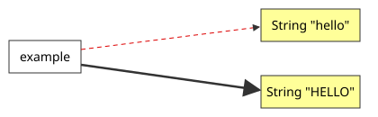

## Core concepts

**Manuel de Codage (MdC)** is the plain-text encoding for Egyptian hieroglyphs (for instance `i-w-r:a-ra-m-p*t:pt`). JSesh reads, edits, renders and writes MdC.

### Representing a text

Three types represent hieroglyphic texts, with increasing richness:

| Type | What it is | Package |
|---|---|---|
| `HieroglyphicText` (formerly `TopItemList`) | The **actual hieroglyphic text**: a tree of hieroglyphs, cadrats, cartouches, line breaks... This is the in-memory representation of a text. | `jsesh.model` |
| `MDCDocument` | A `HieroglyphicText` **plus** file metadata (path, encoding, dialect, preferences). It's what you load from and save to disk. | `jsesh.document` |
| `HieroglyphicTextModel` | A **live, observable, undoable** wrapper around a `HieroglyphicText`, used by the editor. | `jsesh.document` |

Rule of thumb:

- batch or server code which only transforms text: use `HieroglyphicText`;
- loading and saving files: use `MDCDocument`;
- anything interactive (an editor, undo/redo, change notification): use `HieroglyphicTextModel`.

### Rendering

Rendering needs two contexts:

- a `JSeshRenderContext`: *what* to draw with (a style and a font/shape repository);
- a `JSeshTechRenderContext`: *where* to draw (the `Graphics2D`, the device scale).

The `MDCDrawingFacade` class hides both in the usual cases. See [Rendering](/developpers_guide/jsesh_8/rendering).

### Resources

Fonts, sign database and completion data are grouped in a `HieroglyphResources` object, which you build with `HieroglyphResourcesBuilder`. See [Resources and fonts](/developpers_guide/jsesh_8/resources_and_fonts).

## Immutable objects and construction builders

In previous versions, some objects (in particular `DrawingSpecification`) were *mutable*, which caused problems when they were **shared** between components (for instance between the editor and the group editor). It was difficult to know who had modified what.

JSesh 8 favours **immutable objects**, as is increasingly common in object-oriented programming. `JSeshStyle`, for instance, is an immutable record. When you need a modified version of an immutable object, you create a new one. That's what happens with Java strings:

~~~java
String example = "Hello";
String upper = example.toUpperCase(); // creates a new string, example is unchanged
~~~

Of course, a *variable* can still be made to point to another object:

~~~java
String example = "Hello";
example = example.toUpperCase();
~~~

Here, `example`, which formerly pointed to the string `"Hello"`, now points to `"HELLO"`; the old string is unchanged.

For composite objects such as `JSeshStyle`, the basic way to get a modified version is to create a new instance:

~~~java
JSeshStyle style = JSeshStyle.DEFAULT;
// New painting specifications
PaintingSpecifications newPainting = ...;
// create a new style with a modified value
JSeshStyle newStyle = new JSeshStyle(
    style.geometry(),
    newPainting,
    style.fonts(),
    style.options());
~~~

This is not very convenient, hence the use of what Martin Fowler calls a **construction builder**. `copy()` gives you a builder initialised with the current values; you change what you need, then call `build()`:

~~~java
JSeshStyle style = JSeshStyle.DEFAULT.copy()
    .options(o -> o.textDirection(TextDirection.RIGHT_TO_LEFT)
                   .smallSignCentered(true))
    .geometry(g -> g.leftMargin(10)
                    .topMargin(10))
    .build();
~~~

Sharing is now explicit rather than implicit. A `JSeshStyle` can safely be used in several places: replacing a value in one of them leaves the others unchanged.

If you *want* several components to share the same style, and follow its changes (for instance to use the same style in all of your editors), use a `JSeshStyleReference`.
